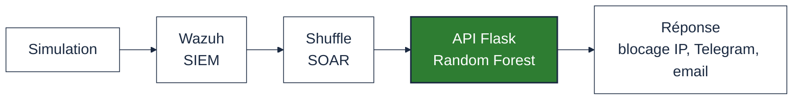
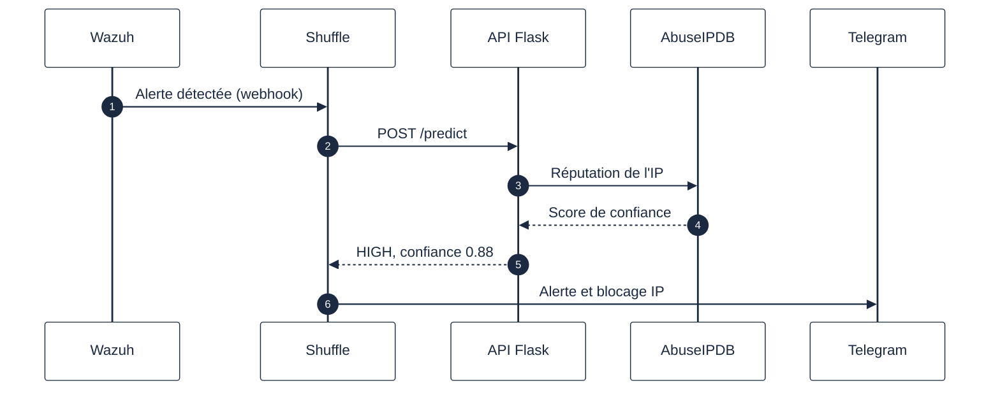

layout: cover
---

  
FSA

  
OCP

# Une IA pour trier les alertes de sécurité

### Insérer un module de Machine Learning entre un SIEM et un SOAR

 

**Hamza Saidi**
Master Data Science et Sécurité des Systèmes d'Information

Encadrant pédagogique&nbsp;: Pr.&nbsp;Mohamed El Fezazi 
Encadrants OCP&nbsp;: M.&nbsp;Fahmi Abderrahim, M.&nbsp;Erraji Hamza 
Année universitaire 2025-2026

<!--
[0:00] Bonjour, je m'appelle Hamza Saidi. Mon PFE répond à un problème concret
rencontré sur le terrain à l'OCP, que je vais vous présenter.
-->

---

# Le problème chez OCP

Le SIEM de l'OCP (Wazuh) surveille déjà l'infrastructure en continu.

~100 alertes / seconde

Brancher un SOAR dessus sans trier avant ne change rien&nbsp;: il reçoit le même flux brut et finit tout aussi saturé que le SIEM. Les analystes restent noyés, juste dans un autre outil.

<!--
[0:40] Le vrai souci n'est pas l'absence d'outil SOAR, c'est l'absence de tri
en amont. J'ai identifié ça moi-même en observant le déploiement en cours.
-->

---

# L'idée

Ajouter une couche qui <strong>classe chaque alerte</strong>
selon son comportement réel,
pas selon un simple seuil fixe.

Fréquence des attaques · répétition depuis la même source · réputation de l'IP

<!--
[1:30] C'est l'idée centrale que j'ai proposée et fait valider par mon
encadrant OCP. Tout le reste du projet en découle.
-->

---

# Architecture du système

Wazuh et Shuffle sont retenus pour trois raisons&nbsp;: open source, webhooks natifs, déploiement Docker simple.

<!--
[2:30] Cinq briques, chacune avec un rôle précis. La brique IA au centre
est celle que j'ai conçue et développée.
-->

---

# Que se passe-t-il pour une alerte&nbsp;?

Exemple&nbsp;: une attaque par force brute sur SSH

Temps mesuré&nbsp;: 1,231 seconde

<!--
[3:30] Tout ce cycle, de la détection à la notification, tient en un peu
plus d'une seconde. C'est largement sous notre objectif de 2 secondes.
-->

---

# Pourquoi pas un dataset existant&nbsp;?

Premier essai&nbsp;: entraîner le modèle sur **CICIDS2017**, un dataset public de référence.

Les 5 features les plus importantes de ce dataset (60,9&nbsp;% du score) viennent toutes de captures réseau&nbsp;: taille de paquets, port de destination... Une alerte Wazuh ne contient aucune de ces informations.

Résultat&nbsp;: <strong>2&nbsp;410 à 2&nbsp;436</strong> alertes réelles classées à tort comme du trafic normal.

Un dataset réseau ne peut pas servir à classer des logs système.

<!--
[4:45] C'est le vrai tournant du projet&nbsp;: j'ai dû abandonner CICIDS2017
et construire mon propre dataset à partir de vraies alertes Wazuh.
-->

---

# Les données et les critères retenus

**3&nbsp;945 alertes**, 3 classes

| Classe | Part |
|---|---|
| HIGH | 44,5&nbsp;% |
| LOW | 31,9&nbsp;% |
| MEDIUM | 23,6&nbsp;% |

**Top critères du modèle**

| Critère | Poids |
|---|---|
| Niveau Wazuh | 26,9&nbsp;% |
| Répétitions (10 min) | 13,8&nbsp;% |
| Fréquence (5 min) | 13,1&nbsp;% |
| Réputation IP | 8,3&nbsp;% |

<!--
[5:45] 11 critères au total, mais ceux-ci dominent la décision. Les deux
du milieu sont calculés en direct à partir de l'historique des alertes.
-->

---

# Le modèle et ses résultats

Un **Random Forest** à 200 arbres, choisi pour sa robustesse et sa capacité à gérer des classes déséquilibrées.

| Classe | Précision | Rappel | F1 |
|---|---|---|---|
| HIGH | 1,00 | 1,00 | 1,00 |
| LOW | 1,00 | 1,00 | 1,00 |
| MEDIUM | 1,00 | 1,00 | 1,00 |

100&nbsp;% sur 789 alertes de test, mais attention&nbsp;: le modèle apprend la règle qui a servi à construire les labels. Ça prouve sa cohérence, pas sa capacité à généraliser à un autre site.

<!--
[6:45] J'insiste sur cette nuance volontairement&nbsp;: un 100&nbsp;% qui
cache un biais de construction n'a aucune valeur si on ne le signale pas.
-->

---

# Mieux qu'un simple seuil

Même règle Wazuh (niveau 5), deux issues différentes&nbsp;:

| Alertes | Répétitions | Décision |
|---|---|---|
| 1 à 8 | 0 à 7 | MEDIUM |
| 9 | 8 | **HIGH** |

Un seuil fixe du type <code>niveau&nbsp;&gt;=&nbsp;7</code> n'aurait jamais vu ce changement&nbsp;: il ne regarde que l'alerte en cours, jamais son historique.

Le modèle a appris un comportement, pas juste une règle Wazuh.

<!--
[7:45] C'est la preuve expérimentale de l'intérêt du ML ici&nbsp;: la
même source, vue plusieurs fois, finit par déclencher une vraie réaction.
-->

---

# Le pipeline en conditions réelles

Trois scénarios testés de bout en bout, sans réglage manuel entre chacun&nbsp;:

| Scénario | Résultat | Action |
|---|---|---|
| LOW (niveau 3) | confiance 76-98&nbsp;% | journalisation |
| MEDIUM (XSS) | confiance 63&nbsp;% | notification analyste |
| HIGH (IP malveillante) | confiance 88-94&nbsp;% | blocage + alertes |

Sur le cas HIGH&nbsp;: blocage IP, Telegram et email partent en parallèle, le tout en moins de 10 secondes.

<!--
[8:30] Les trois branches du pipeline fonctionnent réellement, pas
seulement sur le papier.
-->

---

# Ce que je n'ai pas encore résolu

- Dataset constitué en laboratoire, pas sur des IPs attaquantes réelles
- Le blocage IP est validé côté API, mais il faut un agent Wazuh sur chaque serveur pour qu'il agisse vraiment
- Pas encore d'étude d'ablation formelle sur les 11 critères
- L'API tourne encore en mode développement, pas en production

<!--
[9:10] Je préfère les citer moi-même que les laisser découvrir en
question. Aucune de ces limites ne remet en cause le résultat central.
-->

---
layout: center
---

# En résumé

Une couche de Machine Learning entre Wazuh et Shuffle, qui classe chaque alerte selon son comportement réel plutôt que selon un seuil fixe.

Deux alertes de même niveau Wazuh peuvent recevoir deux traitements différents&nbsp;: c'est ce qu'un simple seuillage ne permet pas, et c'est la contribution centrale de ce travail.

 

Prochaine étape&nbsp;: déployer un agent Wazuh sur l'infrastructure OCP pour rendre le blocage IP effectif.

Merci de votre attention — questions bienvenues

<!--
[9:40] Je termine ici, prêt à répondre à vos questions.
-->
